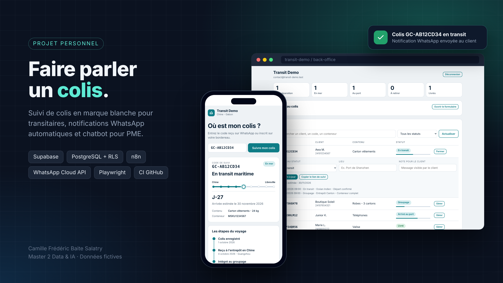
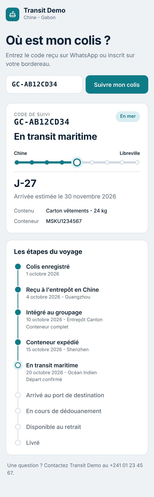
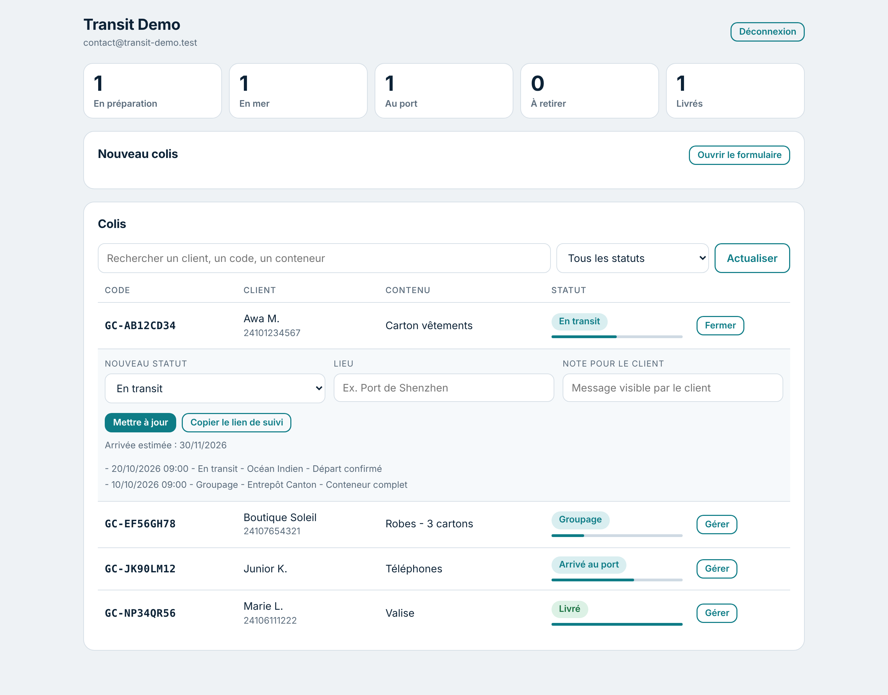

# Suivi de colis et chatbot WhatsApp

Projet personnel : une plateforme de suivi de colis en marque blanche pour transitaires, avec notifications WhatsApp automatiques, et un chatbot WhatsApp multi-clients pour PME.



Les captures et la vidéo utilisent des données fictives.

<p align="center">
  
  &nbsp;&nbsp;
  
</p>

Démo vidéo (26 s) : [docs/demo.mp4](docs/demo.mp4)

## Ce que fait le projet

**Suivi de colis**
- Le client saisit son code et voit son colis avancer : entrepôt, groupage, expédition, transit, port, dédouanement, retrait, livraison.
- Le transitaire gère ses colis depuis un back-office (recherche, filtres, changement de statut avec lieu et note).
- Chaque changement de statut est historisé et déclenche une notification WhatsApp au client.

**Chatbot WhatsApp**
- Un seul workflow sert plusieurs entreprises : chaque client est une ligne en base (prompt, base de connaissances, numéro WhatsApp), sans changement de code.
- Les questions que le chatbot ne sait pas traiter sont marquées pour être reprises par un humain.

## Architecture

```
Client (page de suivi)  ──►  Supabase (Postgres, Auth, RLS)  ◄──  Back-office transitaire
                                     │
                         Database Webhook (INSERT)
                                     ▼
                                    n8n  ──►  WhatsApp Cloud API
                                     ▲
                Message WhatsApp ────┘  (chatbot : contexte en base + modèle de langage)
```

| Brique | Rôle |
|---|---|
| Supabase | Base Postgres, authentification du transitaire, sécurité par ligne (RLS) |
| n8n | Orchestration : réception des messages, appel au modèle de langage, notifications |
| WhatsApp Cloud API | Envoi des messages et des modèles de notification |
| Vercel | Hébergement statique des pages, en-têtes de sécurité |

## Choix techniques

- **Sécurité dans la base, pas dans l'interface.** Un transitaire ne peut lire et modifier que ses propres colis : politiques RLS et fonctions `security definer` qui vérifient `auth.uid()` (voir `suivi-colis/migration-backoffice.sql`).
- **Accès public minimal.** La page de suivi n'appelle qu'une fonction, `track_shipment`, qui renvoie uniquement les informations utiles au client pour un code donné.
- **Historique automatique.** Un trigger enregistre chaque changement de statut dans `shipment_events`, ce qui alimente l'historique et les notifications.
- **Aucune clé secrète côté navigateur.** Le build refuse une clé `service_role` et n'écrit que des valeurs publiques dans `config.js`.
- **En-têtes de sécurité** (CSP stricte, HSTS, `noindex` sur le back-office) définis dans `vercel.json`.

## Structure

```
schema.sql                         Tables, triggers, fonctions et RLS
seed-exemple.sql                   Données de test fictives
suivi-colis/                       Page de suivi, back-office, migration, workflow de notification
chatbot-whatsapp/                  Workflow n8n du chatbot multi-clients
scripts/build.js                   Construction du site et génération de config.js
tests/                             Tests SQL, navigateur et workflows
.github/workflows/ci.yml           Intégration continue
```

## Tests

Les tests tournent à chaque push via GitHub Actions :
- **SQL** : schéma, fonctions et politiques de sécurité sur un Postgres réel ;
- **navigateur** : page de suivi et back-office avec Playwright, Supabase simulé ;
- **workflows** : validité des fichiers n8n et syntaxe des nœuds Code.

```bash
npm ci
npx playwright install chromium
npm test
```

Les tests SQL utilisent un Postgres local (`PGHOST`, `PGUSER`, `PGPASSWORD`).

## Pistes data et IA

Chaque changement de statut laisse une trace datée et localisée. Prochaines explorations :
- estimer la date d'arrivée à partir de l'historique des trajets ;
- détecter un colis en retard avant que le client ne s'en inquiète ;
- mesurer quand le chatbot doit passer la main à un humain.

## Auteur

Camille Frédéric Baite Salatry, étudiant en Master 2 Data & IA à Nexa Digital School (Lyon), en recherche d'alternance.
[LinkedIn](https://www.linkedin.com/in/camille-fr%C3%A9d%C3%A9ric-baite-salatry-49b2462b4/)
